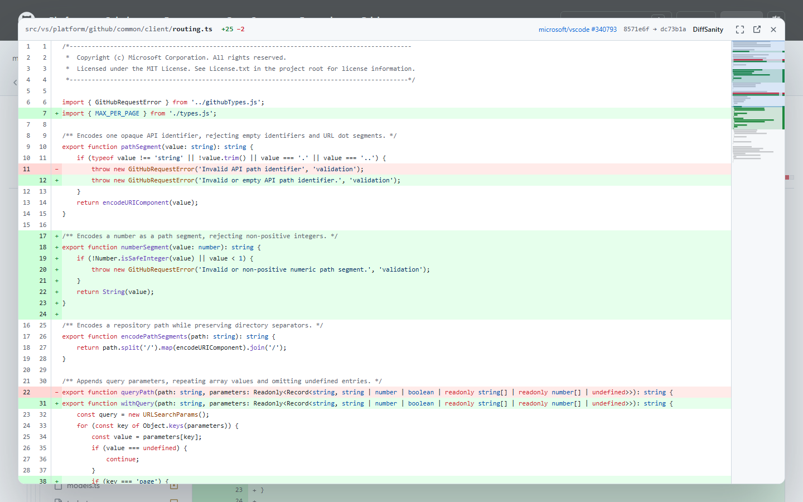
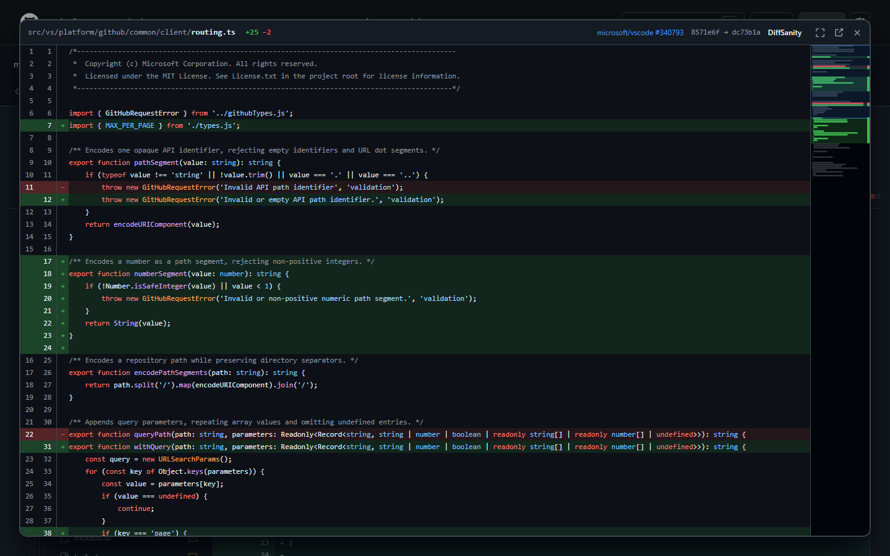
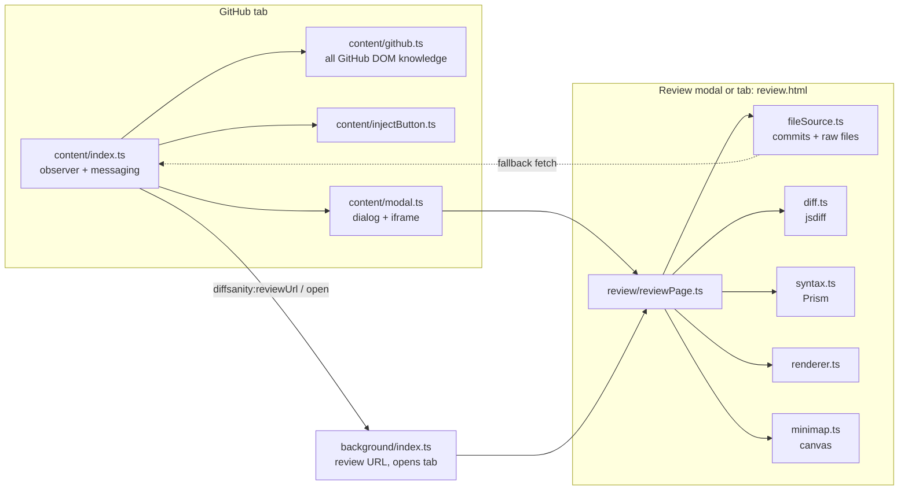

# DiffSanity

**Bring sanity back to GitHub diffs.**

DiffSanity is a Chrome extension (Manifest V3) for reviewing GitHub pull requests. It adds a **DiffSanity** button to every file on a PR's *Files changed* tab. The button opens that file in a focused review **modal** over GitHub:

- The **whole file** is shown, not just the diff hunks, as a unified diff with changes highlighted.
- **Old and new line numbers** are shown side by side in the gutter.
- **Syntax highlighting** follows GitHub's colours.
- An **Azure DevOps / VS Code-style minimap** on the right shows where every change is. Click or drag it to jump.
- The modal toolbar has **Full screen**, **Open in new tab** and **Close** buttons. **Esc** or a click on the backdrop also closes it.
- **Ctrl/⌘-click** the button to open the review in a background tab instead. In a tab, **Back to GitHub** returns to the PR tab you came from and closes the review tab.
- **Dark and light mode** follow your GitHub theme.

Everything runs in your browser. There is no backend, no OAuth and no tokens.

| Review modal (light) | Review modal (dark) |
| --- | --- |
|  |  |

| GitHub file header | Review tab (light) | Review tab (dark) |
| --- | --- | --- |
|  |  |  |

## Install (unpacked)

Requires Node.js 20+.

```sh
npm install
npm run build
```

1. Open `chrome://extensions` and turn on **Developer mode**.
2. Click **Load unpacked** and select the `dist/` folder.
3. Open any pull request's **Files changed** tab and click **DiffSanity** on a file.

## Development

| Command | What it does |
| --- | --- |
| `npm run build` | Bundles `src/` with esbuild into `dist/` |
| `npm run watch` | Rebuilds on change; reload the extension in `chrome://extensions` |
| `npm run typecheck` | `tsc --noEmit` (strict) |
| `npm test` | Unit tests (Vitest + jsdom) |
| `npm run e2e` | Loads `dist/` in Playwright's Chromium against real public PRs and saves screenshots to `docs/screenshots/`. First run: `npx playwright install chromium` |
| `npm run icons` | Regenerates `icons/*.png` (pure Node, no dependencies) |

## Architecture



| Path | Responsibility |
| --- | --- |
| `src/content/github.ts` | **The only module that knows GitHub's DOM.** Finds file headers (path, old path, status, anchor), the commits being compared, and the colour mode. |
| `src/content/injectButton.ts` | Adds one button per header. Idempotent: it is safe to run on every DOM change. |
| `src/content/index.ts` | Watches the DOM (`MutationObserver`, throttled to 150 ms) plus `turbo:load`/`popstate`, so buttons survive client-side navigation, lazy-loaded files and re-renders. Acts only on `/pull/N/files` (and `/changes`). |
| `src/content/modal.ts` | Shows `review.html` in an `<iframe>` inside a native `<dialog>`, which gives a focus trap, Esc handling and the top layer for free. It closes or toggles full screen only on messages from its own frame with the extension origin. `html:has(dialog[open])` locks page scrolling, so the lock can't get stuck. |
| `src/background/index.ts` | Builds the `review.html?<request>` URL for the modal, and opens it in a tab next to the source tab. |
| `src/shared/githubContext.ts` | Pure helpers: URL parsing, commit extraction, rename parsing, raw URLs, review-request (de)serialisation and validation, and the allowed-origin list. |
| `src/review/fileSource.ts` | Resolves the base/head commits and downloads both file versions. |
| `src/review/diff.ts` | Line diff (jsdiff `diffArrays`, 3 s timeout) to a normalised `DiffLine[]` model. |
| `src/review/syntax.ts` | Highlights whole files with Prism, so multi-line comments and strings are correct, then splits the output into per-line HTML. |
| `src/review/renderer.ts` | Renders rows at a fixed 20 px height in 200-line `content-visibility: auto` chunks. This keeps large files fast while Ctrl+F still finds everything. |
| `src/review/minimap.ts` | Canvas minimap with change bands, a code-shape outline and a change ruler. The canvas is only redrawn on resize or theme change; scrolling just moves the viewport element. |

### How the file is retrieved

1. **Commits.** The commits are read from the PR page when the button is clicked, from `start_commit_oid`/`base_commit_oid` and `end_commit_oid` in GitHub's lazy-load URLs. The base is the **merge base** (or the start of a selected commit range), which is what GitHub diffs against, not the base-branch tip. If they are missing, the review page fetches the PR page HTML itself. As a last resort it uses the public REST API (`pulls/N`, then `compare` for the merge base).
2. **Contents.** Both files are fetched from `https://github.com/{owner}/{repo}/raw/{sha}/{path}`. Renamed files use the old path for the base. If the review page's own request is refused, it asks the content script in the GitHub tab to fetch the file from the page's origin.
3. **Status.** A 404 on one side means the file was added or deleted. Binary files (any NUL character in the first 8 KB) are rejected with a message.

## GitHub DOM dependencies

All selectors live in `src/content/github.ts` (and the commit regexes in `src/shared/githubContext.ts`). If GitHub changes its markup, these are the only places to fix.

| What | Classic (server-rendered) view | React ("new Files changed") view |
| --- | --- | --- |
| File header | `.file-header[data-path]` | `h3 a[href^="#diff-"]` inside `[class*="DiffFileHeader-module__diff-file-header"]` |
| File path | `data-path` | `[data-file-path]` in the header, else the link text |
| Rename | link `title`/text `old → new` | link text `old → new` |
| Deleted | `data-file-deleted="true"` | inferred from a 404 on the head side |
| Anchor (for "Back") | `data-anchor` | `href="#diff-…"` |
| Button placement | end of `.file-info` | after the `h3` |
| Commits | `[data-url*="commit_oid"]` / `[src*="commit_oid"]`, then `script[type="application/json"]`, then `.file-header a[href*="/blob/<sha>/"]`, then the full page HTML | same sources |
| Theme | `html[data-color-mode]` (`auto` resolves via `prefers-color-scheme`) | same |

The selectors rely on semantic data attributes and stable link shapes rather than generated class names. The one exception is a substring match on `DiffFileHeader-module__diff-file-header`, which is only used to find the header root. If it is missing, the `h3`'s parent is used instead.

## Tested

Unit tests cover URL and commit parsing, the classic and React header fixtures, button idempotency, the diff model, syntax line-splitting and the minimap maths. `npm run e2e` checks these against live github.com:

- A 15-file PR: one button per header, the modal renders the whole file with line numbers, highlighting and changes, a minimap click scrolls, and the GitHub page behind it doesn't scroll.
- Modal controls: full screen on and off, Esc inside the review, backdrop click, close button, only one modal at a time, and "Open in new tab".
- A 2,745-line file renders in about 0.5 s, and clicking the bottom of the minimap reaches the end of the file.
- A renamed file loads the old path and shows "renamed from".
- Navigating Conversation → Files changed works. A `pushState` URL change plus a newly rendered file header gets a button only on the Files tab.
- Light and dark mode on both GitHub and the review page.
- Ctrl/⌘-click opens a tab, and **Back to GitHub** focuses the source tab and closes the review.

## Known limitations

- **React "new Files changed" view is not verified on a real PR.** Logged-out users always get the classic view. The React selectors were checked on commit pages, which use the same components, and against Refined GitHub's selectors. Please report any header the button doesn't appear on.
- **Private repositories are not verified.** Requests include your GitHub cookies, with a same-origin fallback through the GitHub tab, but this has not been tested while signed in.
- The diff is computed locally with jsdiff, so hunks can occasionally be grouped differently from GitHub's. If a diff takes longer than 3 s, the file is shown as fully replaced, with a notice.
- Commit detection on the React PR page relies on embedded JSON key names that have not been verified. If they are missing, it falls back to the PR HTML and then the public API. The API is rate limited and only works for public repos.
- Very long lines are measured in `ch` units, so wide (CJK) characters can make the horizontal scroll width slightly short.
- github.com only. GitHub Enterprise needs an origin added in `isAllowedOrigin` and in the manifest's `matches`, `host_permissions` and `web_accessible_resources`.
- Not implemented yet: review comments, a side-by-side view, j/k change navigation, a file tree, word-level highlighting and a native file viewer for images. The normalised `FileDiff` model and the separate renderer and minimap are meant to make these additive.
