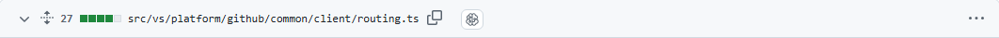
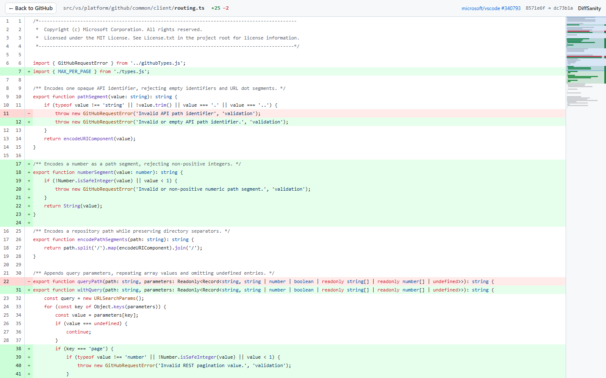
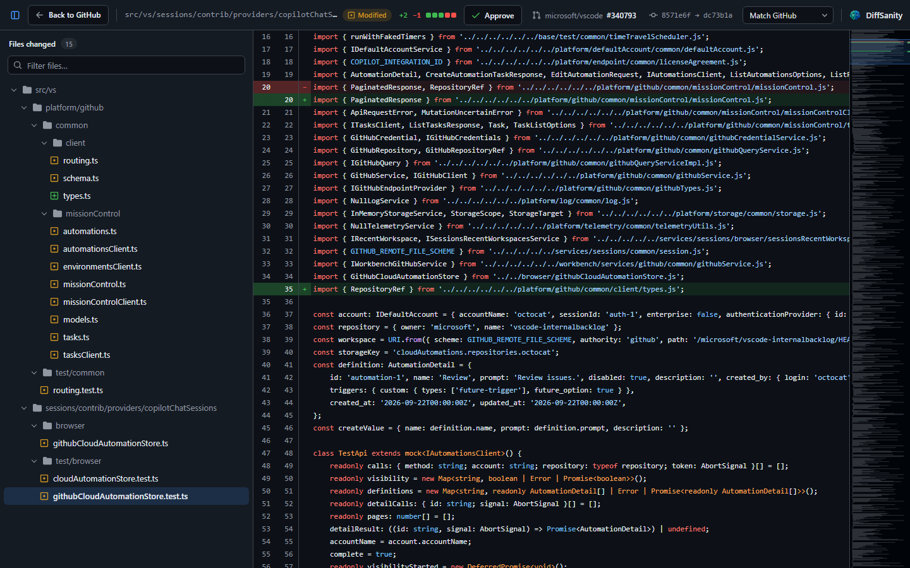
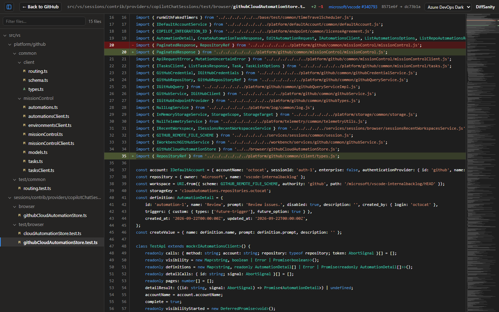
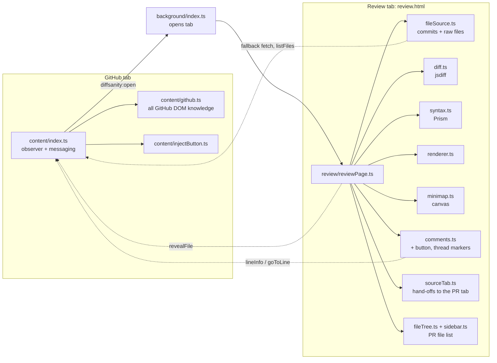

<p align="center"></p>

# DiffSanity

**Bring sanity back to GitHub diffs.**

DiffSanity is a Chrome extension (Manifest V3) for reviewing GitHub pull requests. It adds a **DiffSanity** icon button to every file on a PR's *Files changed* tab, and a **DiffSanity** button next to GitHub's **Submit review** that opens the PR's first file. The button opens that file in a focused review page:

- The **whole file** is shown, not just the diff hunks, as a unified diff with changes highlighted.
- **Old and new line numbers** are shown side by side in the gutter.
- **Syntax highlighting** follows GitHub's colours.
- An **Azure DevOps / VS Code-style minimap** on the right shows where every change is. Click or drag it to jump.
- **All the PR's files in one tab.** A file list on the left, like GitHub's, shows every changed file in a folder tree with its status. Click a file to open it in place, filter by name, or press **Alt+↓** / **Alt+↑** for the next or previous file. Drag the edge to resize it, or hide it with the button at the top left.
- **Comments go through GitHub.** Hover a line and click **+** to open GitHub's own comment box for it in the PR tab. Existing review threads appear as purple markers in the gutter and on the minimap. Click one to jump to the conversation.
- **A clear toolbar** shows the file's path, status, a +/− change bar, the PR and the commits being compared.
- **Approve from the review tab.** The **Approve** button in the toolbar switches to the PR tab and opens GitHub's own review box with *Approve* already selected. You can add a note, then press GitHub's **Submit review**. DiffSanity never submits it for you.
- **Back to GitHub** returns to the PR tab you came from and closes the review tab.
- **Colour themes.** Pick one from the dropdown at the top right: *Match GitHub* (the default, which follows your GitHub light/dark mode), *GitHub Light*, *GitHub Dark*, *Azure DevOps Dark* or *Azure DevOps Light* (the Monaco editor colours and font ADO uses to show files). Your choice is saved in the extension's local storage and applies to all review tabs.

It works on **github.com** and on **GitHub Enterprise Cloud with data residency** (`<enterprise>.ghe.com`).

Everything runs in your browser. There is no backend, no OAuth and no tokens.

| GitHub file header | Review page (light) | Review page (dark) | Azure DevOps Dark |
| --- | --- | --- | --- |
|  |  |  |  |

## Install (unpacked)

Requires Node.js 24 LTS (or 22.22.2+). Building alone works on Node 20, but the tests need the newer versions.

```sh
npm install
npm run build
```

1. Open `chrome://extensions` and turn on **Developer mode**.
2. Click **Load unpacked** and select the `dist/` folder.
3. Open any pull request's **Files changed** tab and click **DiffSanity** on a file.

Ctrl/⌘-click the button to open the review in a background tab.

## Development

| Command | What it does |
| --- | --- |
| `npm run build` | Bundles `src/` with esbuild and compiles `styles/review.css` with Tailwind CSS into `dist/` |
| `npm run watch` | Rebuilds on change; reload the extension in `chrome://extensions` |
| `npm run typecheck` | `tsc --noEmit` (strict) |
| `npm test` | Unit tests (Vitest + jsdom) |
| `npm run e2e` | Loads `dist/` in Playwright's Chromium against real public PRs and saves screenshots to `docs/screenshots/`. First run: `npx playwright install chromium` |
| `npm run package` | Builds and zips `dist/` into `release/diffsanity-<version>.zip` for the Chrome Web Store and Edge Add-ons. Bump `version` in both `manifest.json` and `package.json` first |

Contributing (people or AI agents): read [AGENTS.md](AGENTS.md) for the rules, code style, testing and release process.

**Branding.** `assets/icon.png` (512 px) is the source for the extension icons in `icons/` (16/32/48/128 px; the 128 px icon follows the Chrome Web Store's 96 px artwork with 16 px padding). `assets/logo.png` is the logo with the wordmark. The GitHub button uses an inline SVG in `src/content/injectButton.ts`.

## Architecture



| Path | Responsibility |
| --- | --- |
| `src/content/github.ts` | **The only module that knows GitHub's DOM.** Finds file headers (path, old path, status, anchor), the PR's full file list, the commits being compared and the colour mode. It also reads which diff lines and review threads GitHub renders, scrolls GitHub to a file, and opens GitHub's comment box. |
| `src/content/injectButton.ts` | Adds one button per header, and one pull request button next to GitHub's review button. Idempotent: it is safe to run on every DOM change. |
| `src/content/index.ts` | Watches the DOM (`MutationObserver`, throttled to 150 ms) plus `turbo:load`/`popstate`, so buttons survive client-side navigation, lazy-loaded files and re-renders. Acts only on `/pull/N/files` (and `/changes`). |
| `src/background/index.ts` | Opens `review.html?<request>` next to the source tab. |
| `src/shared/githubContext.ts` | Pure helpers: URL parsing, commit extraction, rename parsing, raw URLs, review-request (de)serialisation and validation, and the allowed-origin list. |
| `src/review/reviewPage.ts` | Runs the review tab. Switches files in place, caches each loaded file and its scroll position, and keeps the URL and the GitHub tab in step with the open file. |
| `src/review/fileSource.ts` | Resolves the base/head commits, gets the PR's file list (from the GitHub tab, or by fetching the PR page) and downloads both file versions. |
| `src/review/fileTree.ts` | Builds the folder tree (folders first, single-child folders merged) and renders the file list with filtering and keyboard navigation. |
| `src/review/diffstat.ts` | Works out the five-block +/− change bar shown in the toolbar. |
| `src/review/sidebar.ts` | Shows, hides and resizes the file list, and remembers its width and visibility in `localStorage`. |
| `src/review/diff.ts` | Line diff (jsdiff `diffArrays`, 3 s timeout) to a normalised `DiffLine[]` model. |
| `src/review/syntax.ts` | Highlights whole files with Prism, so multi-line comments and strings are correct, then splits the output into per-line HTML. |
| `src/review/renderer.ts` | Renders rows at a fixed 20 px height in 200-line `content-visibility: auto` chunks. This keeps large files fast while Ctrl+F still finds everything. |
| `src/review/minimap.ts` | Canvas minimap with change bands, a code-shape outline, a change ruler and review-thread marks. The canvas is only redrawn on resize, theme or thread changes; scrolling just moves the viewport element. |
| `src/review/themes.ts` | The theme list, and how the saved choice resolves to a theme (`auto` follows GitHub's mode). Choices are stored in `localStorage` (`diffsanity.theme`), so they apply before first paint and sync to open tabs. The colours themselves are `:root[data-theme="…"]` CSS variables in `styles/review.css`. |
| `src/review/comments.ts` | Maps GitHub's line keys (`R12` = new line 12, `L7` = old line 7) onto the full-file diff. Shows **+** on lines GitHub lets you comment on, and markers for existing threads. Clicking either switches to the PR tab and asks the content script to scroll there and open the comment box. It re-reads the PR tab whenever the review tab becomes visible again. DiffSanity never posts anything itself. |
| `src/review/sourceTab.ts` | Switches to the PR tab and sends it a request (open the comment box, open the review box with *Approve* selected), and switches back to explain when that fails. |

### How the file is retrieved

1. **Commits.** The commits are read from the PR page when the button is clicked, from `start_commit_oid`/`base_commit_oid` and `end_commit_oid` in GitHub's lazy-load URLs. The base is the **merge base** (or the start of a selected commit range), which is what GitHub diffs against, not the base-branch tip. If they are missing, the review page fetches the PR page HTML itself. As a last resort it uses the public REST API (`pulls/N`, then `compare` for the merge base).
2. **Contents.** Both files are fetched from `{origin}/{owner}/{repo}/raw/{sha}/{path}`, where the origin is `https://github.com` or `https://<enterprise>.ghe.com`. Renamed files use the old path for the base. If the review page's own request is refused, it asks the content script in the GitHub tab to fetch the file from the page's origin. That request sends cookies to the page's origin only, because the raw host it redirects to (with a token in the URL) refuses cross-origin requests that carry cookies.
3. **Status.** A 404 on one side means the file was added or deleted. Binary files (any NUL character in the first 8 KB) are rejected with a message.

## GitHub DOM dependencies

All selectors live in `src/content/github.ts` (and the commit regexes in `src/shared/githubContext.ts`). If GitHub changes its markup, these are the only places to fix.

| What | Classic (server-rendered) view | React ("new Files changed") view |
| --- | --- | --- |
| File header | `.file-header[data-path]` | `h3 a[href^="#diff-"]` inside `[class*="DiffFileHeader-module__diff-file-header"]` |
| File path | `data-path` | `[data-file-path]` in the header (missing for added files), else the link text without invisible direction marks (U+200E) |
| Rename | link `title`/text `old → new` | link text `old → new`, or `.sr-only` text `old renamed to new` |
| PR file list | `file-tree [data-tree-entry-type="file"]`: path in `[data-filterable-item-text]`, status from the `octicon-diff-*` icon, anchor from `a[href^="#diff-"]` | `script[data-target="react-app.embeddedData"]` → `payload.pullRequestsChangesRoute.diffSummaries` (`path`, `pathDigest`, `changeType`, line counts) |
| Show a file (from the file list) | `#<anchor>` if rendered, else click `a[href="#<anchor>"]` | same |
| Deleted | `data-file-deleted="true"` | inferred from a 404 on the head side |
| Anchor (for "Back") | `data-anchor` | `href="#diff-…"` |
| Button placement | end of `.file-info` | end of the `h3`'s parent (after GitHub's copy / expand icons) |
| Pull request button | start of `.pr-toolbar .pr-review-tools` (before "Review changes"; empty when signed out) | just before the "Submit review" button (see *Review box*) |
| Commits | `[data-url*="commit_oid"]` / `[src*="commit_oid"]`, then `script[type="application/json"]`, then `.file-header a[href*="/blob/<sha>/"]`, then the full page HTML | same sources |
| Theme | `html[data-color-mode]` (`auto` resolves via `prefers-color-scheme`) | same |
| Diff line (`<anchor>R12` / `<anchor>L7`) | `td[id]` (line-number cells) | `td[data-line-anchor]` (code cell) |
| Review thread | `tr.inline-comments` after the line's row, one `[id^="review-thread-or-comment-id-"]` per thread | `[data-marker-id]` inside the line's code cell |
| Add-comment button | `.js-add-line-comment` in the row | `button[data-add-comment-button]`, rendered once the code cell is focused |
| Review box ("Approve") | `input[name="pull_request_review[event]"][value="approve"]` inside the "Review changes" `<details>`, which is opened | click `button[class*="ReviewMenuButton-module__ReviewMenuButton"]` (or a button whose text starts with "Submit review"), then `input[name="reviewEvent"][value="approve"]` |
| Signed in | `meta[name="user-login"]` has content | same |

The selectors rely on semantic data attributes and stable link shapes rather than generated class names. There are two exceptions. A substring match on `DiffFileHeader-module__diff-file-header` is only used to find the header root; if it is missing, the `h3`'s parent is used instead. A substring match on `ReviewMenuButton-module__ReviewMenuButton` finds the "Submit review" button (for *Approve* and the pull request button); if it is missing, the button is found by its text.

## Tested

Unit tests cover URL and commit parsing, the classic and React header fixtures, button idempotency, the diff model, syntax line-splitting and the minimap maths. They also cover reading diff lines and threads in both views, opening the comment box and the review box with *Approve* selected, and mapping GitHub's line keys onto the full file. `npm run e2e` checks these against live github.com:

- A 15-file PR: one button per header, the review renders the whole file with line numbers, highlighting and changes, and a minimap click scrolls.
- A 2,745-line file renders in about 0.5 s, and clicking the bottom of the minimap reaches the end of the file.
- A renamed file loads the old path and shows "renamed from".
- The pull request button in the toolbar opens the PR's first file.
- Navigating Conversation → Files changed works. A `pushState` URL change plus a newly rendered file header gets a button only on the Files tab.
- Light and dark mode on both GitHub and the review page.
- The theme picker applies Azure DevOps Dark, and the choice survives a reload.
- **Back to GitHub** focuses the source tab and closes the review.
- Review comments, signed out: thread markers match GitHub's threads, there is no **+**, and a marker scrolls the PR tab to the line.
- File list: it lists every file in the PR and marks the open one, clicking a file opens it in place, **Alt+↓** / **Alt+↑** move between files, and the list can be hidden and shown again.

Verified by hand while signed in (React view): **+** opens GitHub's "Add a comment on line R116" box with the cursor in it, and thread markers match on a PR with comments.

Verified by hand on a GHE.com enterprise (internal repository, SSO): buttons appear on every file, the review page loads the whole file with the diff, minimap and revisions, and **+** appears on commentable lines. The file list was checked on two GHE.com PRs (44 and 22 files, including a renamed file): every file is listed and opens without errors. **Approve** opens GitHub's "Finish your review" box on the PR tab with *Approve* selected (nothing was submitted).

## Known limitations

- **You can only comment on lines GitHub shows in its diff.** That means changed lines and the context around them. This is GitHub's rule. Expand hidden lines on GitHub first if you need one of them, then switch back to the review tab and the **+** appears.
- **Classic view, signed in:** opening the comment box there (`.js-add-line-comment`) and the "Review changes" menu for **Approve** are not verified, because signed-in users get the React view. If the comment box fails, the line is still scrolled into view; if the review menu is not found, the review tab says so.
- **Approve** is only offered when the review tab was opened from a PR tab. GitHub does not let you approve your own pull request; the review box then opens with *Approve* greyed out.
- **Private repositories on github.com are not verified.** Requests include your GitHub cookies, with a same-origin fallback through the GitHub tab. This works for internal repositories on GHE.com.
- The diff is computed locally with jsdiff, so hunks can occasionally be grouped differently from GitHub's. If a diff takes longer than 3 s, the file is shown as fully replaced, with a notice.
- Commit detection on the React PR page relies on embedded JSON key names that have not been verified. If they are missing, it falls back to the PR HTML and then the public API. The API is rate limited and only works for public repos.
- Very long lines are measured in `ch` units, so wide (CJK) characters can make the horizontal scroll width slightly short.
- **github.com and `*.ghe.com` only.** GitHub Enterprise Server (self-hosted, any domain) is not supported: each host would need to be granted at runtime through optional host permissions. On GHE.com the public REST API fallback for commits is not used.
- **File list:** the **+** for a file appears once GitHub has rendered that file's lines. Opening a file asks the GitHub tab to show it, so this usually takes a moment. GitHub's "Viewed" checkboxes are not shown or synced. For a renamed file far down a large PR, DiffSanity may need GitHub to render it before it knows the old path.
- Not implemented yet: writing comments inside the review page, a side-by-side view, j/k change navigation, word-level highlighting and a native file viewer for images. The normalised `FileDiff` model and the separate renderer and minimap are meant to make these additive.

## Publishing

`npm run package` builds the store zip. Listing text, privacy answers and store images for the Chrome Web Store and Edge Add-ons are in [`docs/store/`](docs/store/README.md). Store images were made once from the E2E screenshots and are committed as-is.

## Privacy and license

DiffSanity collects no data; see [PRIVACY.md](PRIVACY.md). Released under the [MIT License](LICENSE).
